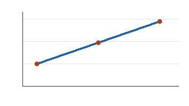

# Introduction {#sec-intro}

Demand doubled last year. We measured the throughput of three node counts
using the same workload and software environment.[^environment]

{#fig-throughput width=70%}

Table: Benchmark results {#tbl-results}

| Nodes | GB/s |
|------:|-----:|
|     1 | 11.2 |
|     2 | 20.8 |
|     3 | 30.1 |

> [!NOTE] Reproducibility
> Record the compiler version alongside every measurement.

:::warning title="Check the quota first"
Requests above eight nodes need sign-off.
:::

## Method {#sec-method}

The following listing computes the mean of the recorded samples.

```python {#lst-load caption="Loading the data" .numbered}
samples = [11.2, 20.8, 30.1]
mean = sum(samples) / len(samples)
print(f"Mean throughput: {mean:.1f} GB/s")
```

The model is $T(n) = W/n + c$, with fixed overhead $c$.

$$ T(n) = \frac{W}{n} + c $$ {#eq-amdahl}

[^environment]: Every run used the same pinned software image.

```{=latex}
\clearpage
```

:::pagebreak
:::

# Next steps {#sec-next}

Repeat the experiment with a larger workload before requesting more nodes.
